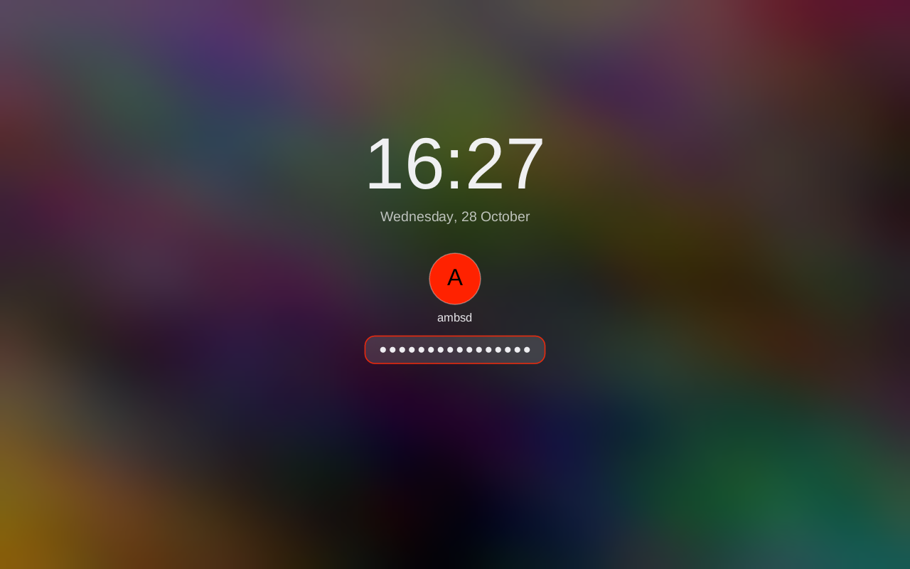

# Lock screen (`declock`)

`declock` is Decebal's screen locker for X11. It replaces the plain i3lock ring with a themed lock screen:

- a blurred, dimmed copy of the desktop at the moment of locking (or the wallpaper), over every monitor;
- a big clock and the date, your picture (`~/.face`, else a disc with your initial) and name;
- a rounded password field that shows one dot per character, with the placeholder "Password";
- feedback: a shake and "Wrong password" for a failed attempt, a back-off with a countdown after repeated failures,
  "Caps Lock is on" while it is.

Keys: type, Backspace, Enter to unlock, Escape or Ctrl+U to clear the field. Everything else (Ctrl/Alt/Super
combinations, function and XF86 media keys) is ignored.

```
declock [--bg screenshot|wallpaper|color] [--blur N] [--dim 0..1]
```

`DECLOCK_BG`, `DECLOCK_BLUR` and `DECLOCK_DIM` set the same options from the environment; `DECLOCK_PAM_SERVICE` picks
the PAM service (default `login`; `i3lock` also exists on most systems, but `login` is the conservative choice).

## Using it from rdwm / xss-lock

`declock` stays in the foreground until the screen is unlocked and then exits 0, and it closes `XSS_SLEEP_LOCK_FD`
once the screen is locked, so it works under `xss-lock --transfer-sleep-lock -- rdwm-lock` unchanged.

`rdwm-lock` (in the rdwm repo, `contrib/rdwm-lock`) should try it first. The one-line change, placed before the
`xsecurelock` line (the Wayland branch above it stays as it is):

```sh
have declock && declock && exit 0   # exits non-zero only if the screen could not be locked: fall through to the others
```

Exit codes: 0 unlocked (or another declock already runs), 1 could not lock (keyboard or pointer grab failed), 2 bad
usage, 3 PAM unusable. In the non-zero cases nothing is left on screen.

## Theme

Everything comes from the shared theme (`decthemectl`, System Settings), so the lock matches the bar and dock:

| Theme key | Used for |
|---|---|
| `accent`, `accent_text` | the avatar disc and its initial, the field's border |
| `danger` | the field border and message after a wrong password (lightened if too dark for the backdrop) |
| `warn` | the Caps Lock hint |
| `radius` | corner radius of the password field (a sharp theme gives a square field) |
| fonts: `display`, `ui` | the clock, and all other text |
| `background` | the backdrop in `--bg color` mode |

Text is always light on the darkened backdrop, in light and dark themes alike. `clockHour12` in `decebal.json`
switches to a 12-hour clock. The panel is centred on the primary monitor and scales with its height.

## How it works

1. Connects to X, copies the root window (in 64-row bands, reduced straight to 1/8 size), blurs and dims it, so a 4K
   screen costs a few hundred kilobytes. With `--bg wallpaper` (or when a screenshot is impossible) the wallpaper
   rdwm shows, else Omarchy's current background, is used; failing that the theme colour.
2. Creates an override-redirect window over the whole root (all monitors), maps it, and grabs keyboard and pointer
   (retrying for 5 s; on failure it exits 1). It re-raises itself on visibility, configure and map events of other
   windows, and once a second. The pointer is hidden and confined to the window.
3. Paints the backdrop once; afterwards only the centre panel is redrawn, when something changed.
4. The event loop sleeps in `poll`: one wake-up per second for the clock, about 60 per second for 450 ms during a
   shake, nothing else. Idle memory is about 7 MB RSS.
5. PAM runs on a worker thread, so the window stays responsive while PAM sleeps after a failure.

Back-off: the first two failures are free; from the third, input is ignored for 1, 2, 4, 8 s and then 8 s each time
(the countdown is shown). Keystrokes during a freeze or a check are dropped, never queued. A PAM malfunction counts as a
failure and shows "Authentication unavailable".

## Security notes

- Authentication is `pam_authenticate` through direct libpam FFI (service `DECLOCK_PAM_SERVICE`, default `login`),
  for the user that started the lock. The conversation callback answers hidden prompts with the password and visible
  ones with the user name, with `malloc`ed copies as PAM requires. `pam_acct_mgmt` and `pam_setcred` are not called
  (like i3lock): an expired or locked account is only refused if the auth stack refuses it.
- The password lives in one fixed-size, `mlock`ed heap buffer that is wiped (volatile writes) on clear, backspace
  and drop; it moves to the worker thread without copying. The process disables core dumps and ptrace-style access
  (`PR_SET_DUMPABLE=0`). It is never logged. Limits: PAM's own copy is freed by PAM, not wiped by us, and X key events
  and keymap lookups hold single characters briefly in ordinary memory.
- Keyboard and pointer are grabbed with `XGrabKeyboard` / `XGrabPointer`; if either cannot be had the lock fails
  (exit 1) instead of showing a lock screen that does not lock.
- Test only: the cargo feature `test-auth` compiles a fake authenticator (`DECLOCK_FAKE_AUTH=1` plus
  `DECLOCK_TEST_PASSWORD`). Release builds, the Makefile, the PKGBUILD and the .deb do not enable it (the PKGBUILD
  deliberately avoids `--all-features`), and `tests/e2e/lock.sh` checks that the shipped binary does not contain it.
- As with every X11 locker: it does not stop VT switching (Ctrl+Alt+Fn) or SysRq (the OS's business), another client
  with X server access to the same display (e.g. with `xhost +`) can still interfere, and killing the process (or a
  crash) unlocks the screen. Dead keys and compose sequences are not supported in the password field.
- Failed attempts go through PAM, so `pam_faillock` counts them like any login failure.

## Tests

`tests/e2e/lock.sh` runs on a private Xvfb (`E2E_DISPLAY`, default 97; never the live display): geometry, blur, dim,
theme accent, dots, Backspace, Escape, Ctrl+U, ignored keys, Caps Lock, shake, back-off and freeze, a successful
unlock with the fake authenticator, exactly one wrong password through real PAM, the XSS fd, grab failure, stacking,
wallpaper/picture/light theme, idle RSS and CPU. Unit tests cover the state machine, the PAM conversation, the
backdrop maths, key decoding and drawing.

## Screenshots

  
