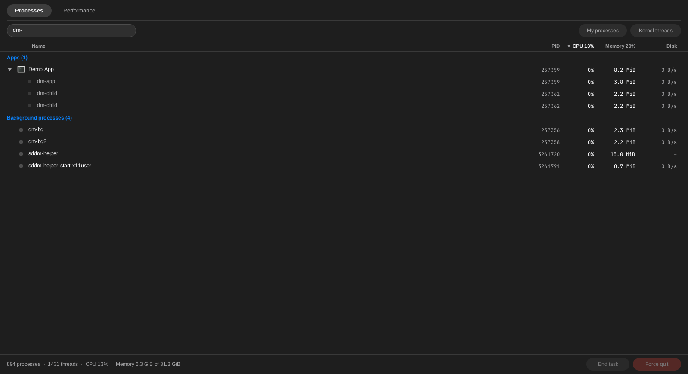
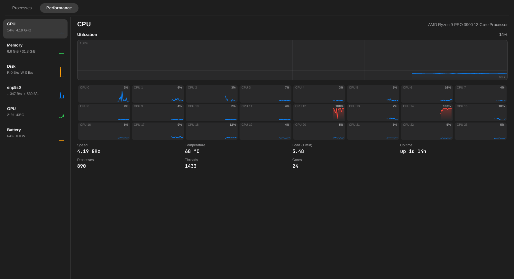

# Activity Monitor (`decmon`)

A process manager and performance monitor in one, in the spirit of Windows' Task Manager and macOS' Activity Monitor.

* the **agents icon** on the bar opens it as a card under the icon (the same style and placement logic as the dashboard popup);
* `decmon` opens it as a normal resizable window; **Activity Monitor** is in the launcher (`contrib/decmon.desktop`), so Spotlight finds it and you can bind a key to it;
* the popup has an **Open Activity Monitor** link that turns it into the window.

```
decmon [processes|performance] [--popup [--x PX] [--top PX]]
```

Running it again while it is open closes it (a toggle). Without a DISPLAY, or on a build without X11, `--popup` opens the window instead.




## Processes

* **Apps and background processes.** A process that belongs to an installed application (its `.desktop` file's `Exec=`, file name, `Icon=` or name matches the process name, or the script an
  interpreter runs) is an app: it shows the app's icon and name, and every process below it in the process tree (and further processes of the same program, such as a browser's helpers) are
  folded into one row with the totals. Click the arrow (or press Right / Left) to unfold it. Everything else is listed as a background process.
* **Columns.** Name, PID, CPU, Memory and Disk. Click a header to sort, click again to reverse; the header also shows the machine's total CPU and memory load. CPU is a percentage of one core, like
  `top` (a program using three cores can show 300 %); it is a delta over the last second. Memory is the resident set size (shared pages are counted in each process that has them). Disk is
  read + write bytes per second as the kernel accounts them (`/proc/<pid>/io`; "–" for processes whose counters are not readable).
* **Search.** Just type. It matches names, command lines and PIDs, unfolds the matching apps and lists only the matching processes. Backspace edits, Escape clears (then closes).
* **Filters.** "My processes" and "Kernel threads" (hidden by default).
* **End task / Force quit.** On a hovered row, the footer buttons act on the selected row, Delete ends the selection, Shift+Delete force quits it. End task sends SIGTERM; Force quit sends SIGKILL and
  asks first ("Unsaved data in it will be lost", Enter confirms, Escape cancels). On an app row the signal goes to every process of the app.

### What can be signalled

| process | End task / Force quit |
|---|---|
| your own processes | yes |
| another user's processes | refused (unless decmon runs as root) |
| PID 1, and decmon itself | always refused |
| `rdwm`, `decbar`, `decdock`, `decnotify`, `decwm`, Hyprland, sway, Xorg, Xwayland, the systemd user manager | only after an extra confirmation that says what will happen |
| kernel threads | only after an extra confirmation (signals do nothing to them) |

A process is identified by its PID **and** start time. The signal is sent through a `pidfd` opened first, the start time is read after that, and nothing is sent when it differs from the listed one: a
PID that was recycled by another program in the meantime is never hit ("had already ended").

## Performance

A list on the left (CPU, Memory, Disk, one entry per network interface, GPU, Battery when there is one), details with 60-second graphs on the right (Tab switches tabs, Up / Down the list).

| item | shows |
|---|---|
| CPU | total utilization graph, one sparkline per core, speed, temperature (hwmon: k10temp / coretemp / zenpower), load, uptime, processes, threads |
| Memory | in use, available, cached, swap graph |
| Disk | read and write throughput of the physical disks (`/proc/diskstats`, partitions, loop and device-mapper devices not counted twice) |
| Network | receive and send per interface (loopback and container bridges left out), totals |
| GPU | NVIDIA through `nvidia-smi` (every other second); AMD through `gpu_busy_percent`, VRAM and hwmon (temperature, power); Intel's clock and temperature through sysfs |
| Battery | power draw in watts (`power_now`, or current times voltage), charge, status |

## Cost

All numbers are read from `/proc` and `/sys` by the window itself; there is no helper and no dependency. Sampling is **once a second and only while the window is open** (a worker thread that stops
when the window closes; it also pauses while the window is hidden). `decbar` does nothing for it: the agents icon only spawns `decmon --popup`, so its memory and CPU do not change. Per-process
command lines are read once per process; history is 60 samples per series, so memory does not grow while it stays open.

## Testing

* Unit tests: `/proc` parsing with fixture trees, CPU and disk deltas, PID reuse, grouping, sorting, searching, the kill guards (`src/procmon/*`).
* `tests/e2e/procmon.sh` (`make e2e-procmon`): a private Xvfb, `HOME` and XDG dirs, dummy processes the test starts itself (symlinks of `sleep` and `bash` named `dm-*`, with a `.desktop` file for an
  "app"), finds them in the list (`DECMON_DUMP=<file>` writes the visible rows), sorts and searches, ends one with Delete, force quits another through the confirmation, ends a group, shoots both
  tabs and the popup, and opens the popup from the bar's agents icon (macOS bar and Caelestia pill bar). Only the PIDs of its own dummies are ever signalled.

Environment: `DECMON_DUMP` (test hook, see above), `DECBAR_POWER_SUPPLY` (battery directory, shared with the bar).
