# Themes gallery

Compatibility designs remain loadable by ID; legacy colour aliases belong in
Palettes rather than the visible theme gallery. All shipped packages now omit
wallpaper defaults, including hidden aliases still copied by `make install`.
Generated-art screenshots are retired. Choose photography explicitly in separate
Wallpaper settings. See [hidden cleanup](hidden-wallpaper-removal.md) and
[visible-package retirement](generated-wallpaper-removal.md).

Apply one with `decthemectl theme apply <id>` (`--preview 10` to try it for 10 seconds, `decthemectl theme undo` to go back).
Anything can then be overridden by the user: `decthemectl theme duplicate <id> mine` makes an editable copy. See [theme-engine.md](theme-engine.md) and [caelestia.md](caelestia.md).

| Theme | Look | Bar | Dock | Titlebars | Apply |
|---|---|---|---|---|---|
| **Caelestia Mocha** | **Caelestia Mocha**: Catppuccin Mocha (Latte in light mode) in the Caelestia shape: a vertical pill bar on the left edge, 20 px radii, tonal mauve surfaces, no dock, Materia circle buttons. | left | hidden (auto) | materia | `decthemectl theme apply caelestia-mocha` |
| **Rose Pine** | **Rose Pine**: Rose Pine dusk (Dawn in light mode): muted rose and gold on plum, a pill bar along the top, a round magnifying dock, traffic-light titlebars. | top | mac, pill | macos | `decthemectl theme apply rose-pine` |
| **Tokyo Night** | **Tokyo Night**: Tokyo Night (Day in light mode): electric blue and violet on navy with a split top and bottom bar, a compact dock, dot buttons. | split | mac, compact | nord | `decthemectl theme apply tokyo-night` |
| **Kanagawa** | **Kanagawa**: Kanagawa Wave (Lotus in light mode): ink-wash blues on sumi ink, a pill bar on the right, serif window titles, a left-aligned Windows-style taskbar, thin minimal titlebars. | right | windows taskbar | minimal | `decthemectl theme apply kanagawa` |
| **Material You Dynamic** | **Material You Dynamic**: fixed compatibility colours with optional Match wallpaper chosen separately. Bottom pill bar, floating dock, Breeze titlebars. | bottom | mac, floating | breeze | `decthemectl theme apply material-you-dynamic` |

Tags: caelestia-mocha `catppuccin pill vertical-bar`, rose-pine `rose-pine top-bar dock`, tokyo-night `neon split-bar`, kanagawa `ink right-bar serif taskbar`, material-you-dynamic `material-you dynamic wallpaper`.

The old `material-you-dynamic` wallpaper-owned extraction defaults are retired. Opt into Match wallpaper independently when desired, see [theming.md](theming.md#match-wallpaper).

## Showcase packages (gruvbox, everforest, synthwave, frutiger aero, adwaita-like)

Five data-only theme packages beyond the built-ins. They live in `themes/<id>/` (manifest and optional widget assets), are installed to
`/usr/share/decebal/themes/<id>/` by `make install`, and are used like any theme:

```
decthemectl theme apply <id>                 # dark or light follows the system; add --mode light|dark on `decthemectl apply`
decthemectl theme apply <id> --preview 10    # try it for 10 s, then everything is put back
decthemectl theme undo
```

Generated wallpapers are no longer shipped by these packages. Font lists name families that are
commonly installed and fall back down the list. Screenshots are taken on a private Xvfb by `tests/e2e/showcase-themes.sh`. What the engine
cannot do yet (real glow or blur, bar item lists, a left-side window-button order) is described in [theme-engine.md](theme-engine.md).

## Gruvbox Dark

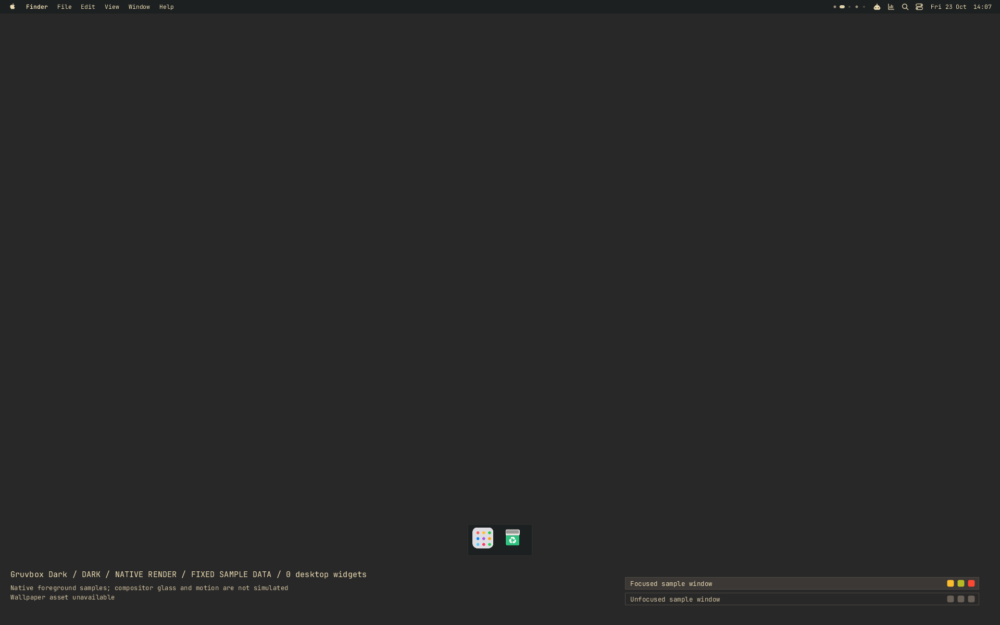

Warm retro tiling rice: thin top bar, square corners, tight gaps, cream on charcoal and earthy orange accents. Includes a light paper variant.

Tags: gruvbox, retro, warm, tiling, square, dark, light. Apply: `decthemectl theme apply gruvbox-dark`

Light variant: 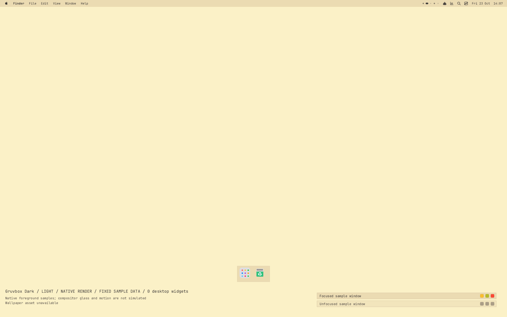

## Everforest

**Everforest**

A calm green-forest palette in soft rounded shapes: a bottom bar with a floating rounded dock, sage and moss accents, and Adwaita-style captions. The light variant is cream parchment.

Tags: everforest, green, calm, rounded, dark, light, nature. Apply: `decthemectl theme apply everforest`

Light variant: **Everforest light**

## Synthwave

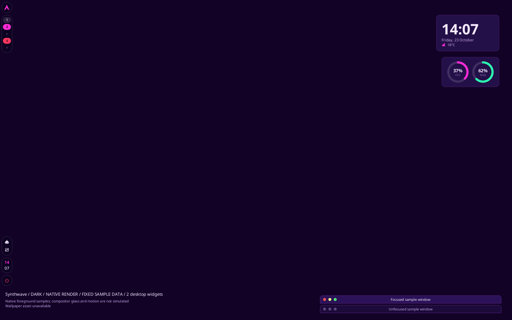

Neon magenta and cyan on deep purple: hot-pink accents, focused cyan borders, left pill bar and rounded dark surfaces. A light daybreak variant retains the hues; native borders provide colour, not compositor glow.

Tags: synthwave, neon, cyberpunk, purple, dark, light, retro. Apply: `decthemectl theme apply synthwave`

## Frutiger Aero

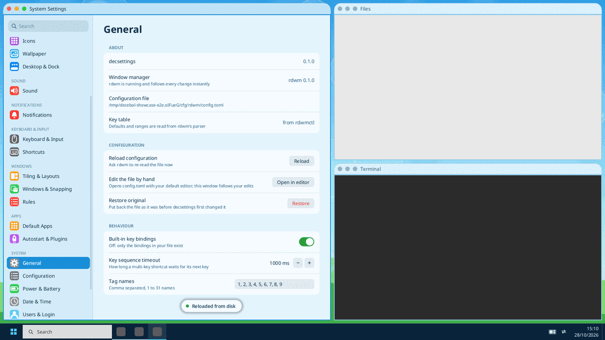

Glossy light-aqua and sky-blue surfaces, rounded glassy cards, a Windows-style taskbar and fresh green accents. Deep-ocean dark and airy light variants.

Tags: frutiger-aero, aqua, glass, light, dark, skeuomorphic, windows7. Apply: `decthemectl theme apply frutiger-aero`

## Adwaita-like

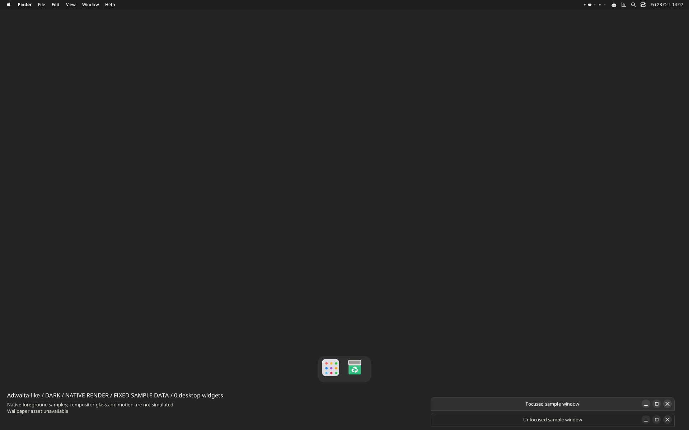

A libadwaita-inspired dark/light design: rounded headerbar-style captions, blue/grey surfaces, slim top panel and installed-font fallbacks. Unaffiliated with GNOME.

Tags: adwaita, libadwaita, clean, light, dark, rounded. Apply: `decthemectl theme apply gnome-adwaita-like`

Light variant: 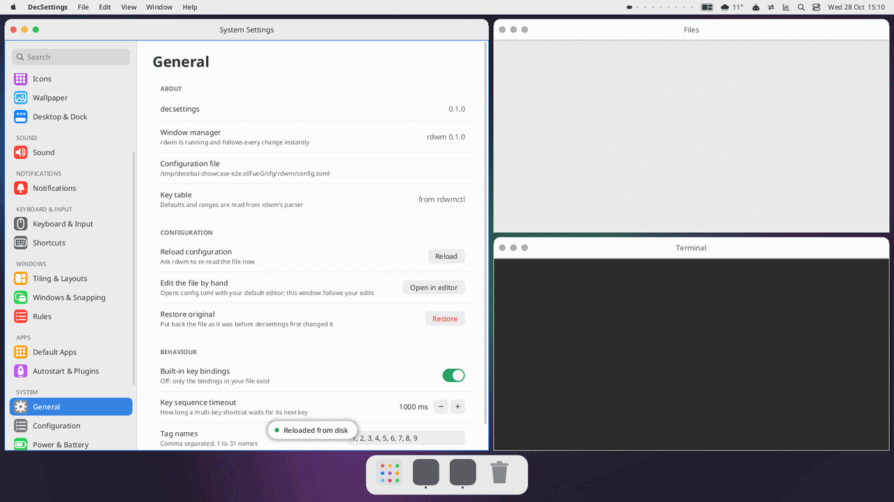

## Gallery

| theme | look | apply |
|---|---|---|
| Gruvbox Dark | warm retro tiling: thin flat bar, square corners | `decthemectl theme apply gruvbox-dark` |
| Everforest | calm green forest, soft rounded, floating dock | `decthemectl theme apply everforest` |
| Synthwave | neon magenta and cyan on deep purple, restrained native borders | `decthemectl theme apply synthwave` |
| Frutiger Aero | glossy aqua and sky blue, glass cards, taskbar | `decthemectl theme apply frutiger-aero` |
| Adwaita-like | clean libadwaita-inspired headerbars, centred titles | `decthemectl theme apply gnome-adwaita-like` |

## Theme gallery

Ready-made looks that ship with decebal. Each one is a [theme package](theme-engine.md): colours for dark (and light where it makes sense),
fonts per role, titlebar style, bar and dock, and optional desktop widgets. Wallpaper is selected separately. Apply one with

```
decthemectl theme apply <id>              # whole design: colours, titlebars, bar, dock, widgets
decthemectl theme apply <id> --preview 10 # try it for 10 s, then everything is put back
decthemectl theme undo                    # step back
```

or with **System Settings -> Theme -> Theme packages**. Package assets are installed
under `/usr/share/decebal/themes/<id>/`. Themes set no wallpaper image/mode/colour
and trigger no photo downloads. Explicit Wallpaper selection remains independent;
unknown-license Wallhaven photos are recommendations rather than bundled assets.

| theme | look | apply |
|---|---|---|
| 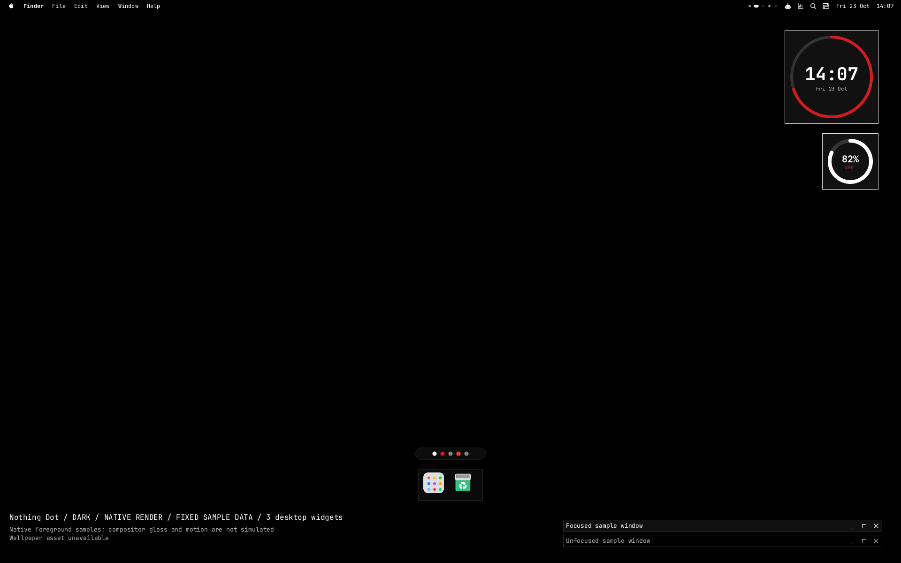 | **Nothing Dot** (dark + light): dot-matrix monochrome after Nothing OS. Black or off-white, one red accent, square flat windows, a native Glyph-style ring clock and battery. Titles and big numbers use Doto / DotGothic16 when installed, otherwise JetBrains Mono. | `decthemectl theme apply nothing-dot` |
| **Nothing Light** | **Nothing Light**: the paper companion. Always light (the package has no dark variant), same native ring widgets. | `decthemectl theme apply nothing-light` |
| 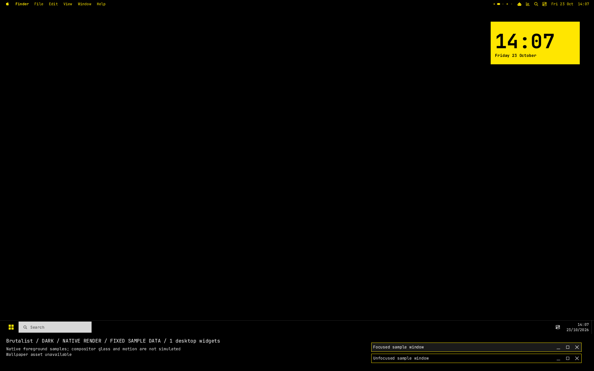 | **Brutalist** (dark + light): zero radius, 4 px borders, black and signal yellow at full contrast, monospace everywhere, flat yellow bar, a Windows-style square taskbar and a slab clock. The light variant is yellow paper with black ink. | `decthemectl theme apply brutalist` |
| 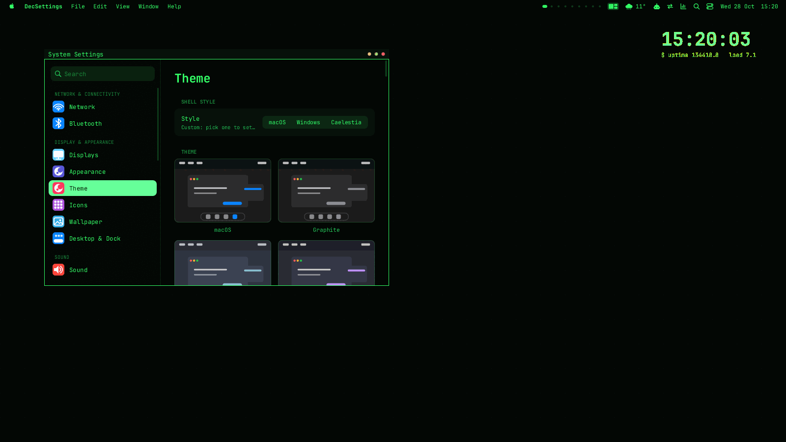 | **Terminal Minimal** (dark + light): green phosphor on black, a 20 px bar, no dock, thin titlebars, a plain tty clock on the desktop. Light variant: dark green ink on paper. | `decthemectl theme apply terminal-minimal` |
| **Terminal Amber** | **Terminal Amber** (dark + light): the same minimal terminal shell in amber phosphor (it `extends` Terminal Minimal and only changes colours and borders). Light variant: brown ink on cream. | `decthemectl theme apply terminal-amber` |

Add `light` or `dark` to pick a variant of a theme that has both: `decthemectl theme apply "brutalist light"`.

## Palettes: colours separate from themes

A theme is the *shape* of the desktop (titlebars, bar, dock, fonts, wallpaper, widgets). A **palette** is only colours, a dark and a light set,
and it works on every theme: pick one and it recolours whichever theme is active, and stays when you switch themes. The theme keeps its radius,
decoration, bar and dock; a palette also colours rdwm's borders (the theme's hard-coded border colours step aside).

| palette | dark / light |
|---|---|
| `catppuccin` | Mocha / Latte |
| `rose-pine` | Rose Pine / Dawn |
| `gruvbox` | dark / light |
| `tokyo-night` | Night / Day |
| `everforest` | dark / light |
| `kanagawa` | Wave / Lotus |
| `nord` | Polar Night / Snow Storm |
| `dracula` | Dracula / Alucard |
| `solarized` | dark / light |
| `monochrome` | greys / greys |

```
decthemectl palette list            # built-in and yours, * = current
decthemectl palette catppuccin      # recolour the current theme
decthemectl palette none            # back to each theme's own colours
decthemectl apply brutalist --accent "#ff8800"     # a custom accent sits on top of the palette
```
In System Settings, **Appearance > Themes** picks the desktop design (macOS, Windows, Caelestia and other distinct designs).
**Appearance > Palettes** contains the colour gallery, light/dark mode, wallpaper colours and custom accent. Choosing a palette
turns off wallpaper recolouring and clears the custom accent so the palette is shown as selected. Applying a desktop theme
restores its own colour palette. Turn on Match wallpaper colours to use a generated palette instead. Translucency and corner radius remain
in **Customise > Colours**. Old colour-based theme packages remain loadable from the CLI, but do not duplicate the palette choices
in the Themes gallery. User-created packages stay visible.

Your own palette is a small file in `~/.config/decebal/palettes/<id>.toml` (`$DECEBAL_PALETTES`), the same colour tokens a theme has:

```toml
name = "Midnight"
description = "Deep blue with a mint accent."
[dark]
background = "#0b1020"   sidebar = "#080c18"   surface = "#141b33"   bar = "#080c18"   bar_text = "#e6ecff"
popup = "#141b33"   dock = "#080c18"   overlay = "#141b33"   titlebar = "#141b33"   titlebar_inactive = "#0b1020"
border = "#27315a"   text = "#e6ecff"   text_secondary = "#a9b4d6"   text_faint = "#7480a8"
accent = "#7df0c4"   accent_text = "#06231a"   danger = "#ff6b81"   ok = "#7df0c4"   warn = "#ffc46b"
```
A palette may have only `[dark]` or only `[light]`; the theme keeps its own colours in the other mode. Keep `text` readable (4.5:1) on every
surface; the built-in palettes are tested that way against every theme in both modes.

## Making your own

`decthemectl theme new mine --from nothing-dot` copies a theme into `~/.config/decebal/themes/mine/`; edit it, `decthemectl theme validate` it,
`decthemectl theme pack` it. See [theme-engine.md](theme-engine.md) for every key and the widget language.

## Tests

`cargo test` also applies every palette to every theme in both modes and checks contrast. `cargo test` checks that every shipped theme parses, validates as a package (optional assets validated, compiled-in manifest equal
to the file) and applies; `tests/e2e/theme-engine.sh` applies each one on a private Xvfb and rdwm and takes the screenshots.


Use an isolated shell configuration for the unit suite; some drawing tests assume the default theme:

```sh
appearance_test_config=$(mktemp -d)
DECEBAL_CONFIG="$appearance_test_config" DECEBAL_THEMES="$appearance_test_config/themes" DECEBAL_PALETTES="$appearance_test_config/palettes" cargo test --lib
```

The appearance regression checks exercise actual palette clicks, design switching, rdwm colours and search/navigation on a private desktop:

```sh
cargo build --bin decsettings --bin decthemectl --bin decbar
MS_BIN_DIR="$PWD/target/debug" dbus-run-session -- tests/e2e/palettes.sh :98
MS_BIN_DIR="$PWD/target/debug" dbus-run-session -- tests/e2e/appearance.sh :97
```

## New desktop designs

These original theme packages have dark and light colours, independently selected photography, and support the shared Widgets library. A selected palette applies across all five.

| Theme | Desktop design | Apply |
|---|---|---|
| 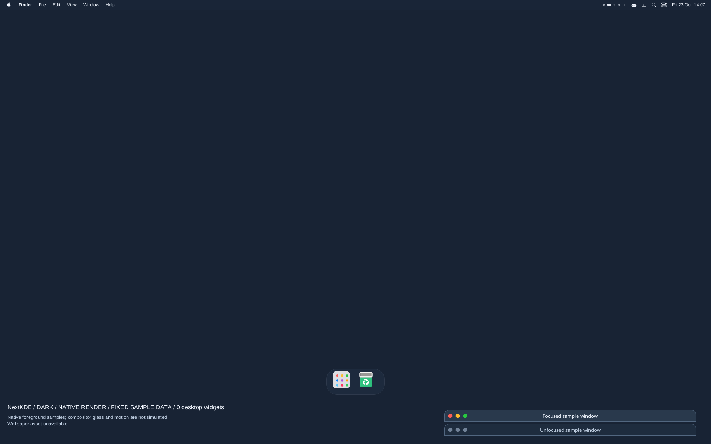 **NextKDE** | Soft glass, slim global top bar and floating dock; inspired by [NextKDE](https://github.com/NextKde/NextKde). | `decthemectl theme apply nextkde` |
| 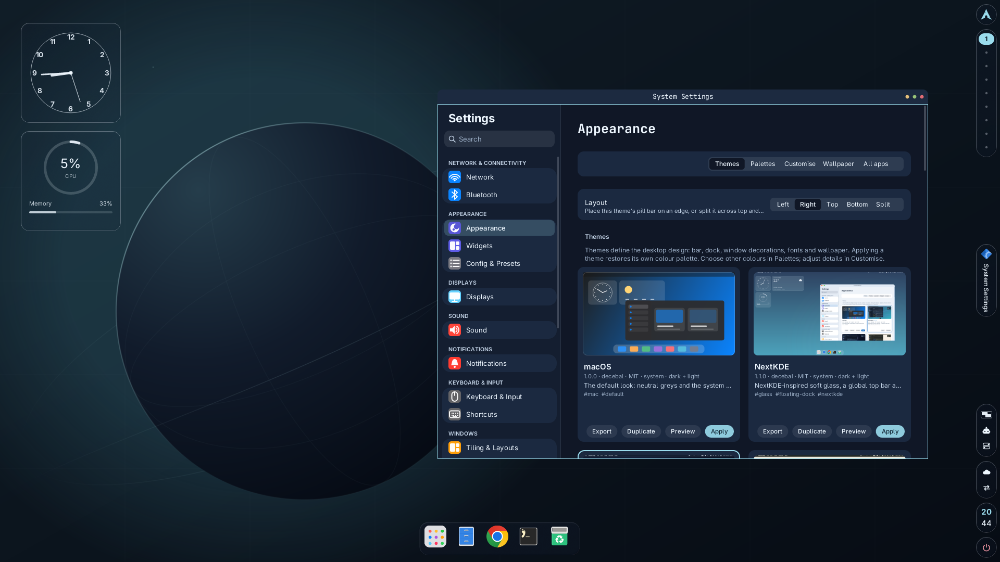 **Orbit Glass** | Floating navigation, rounded windows and a right-hand rail. | `decthemectl theme apply orbit-glass` |
| 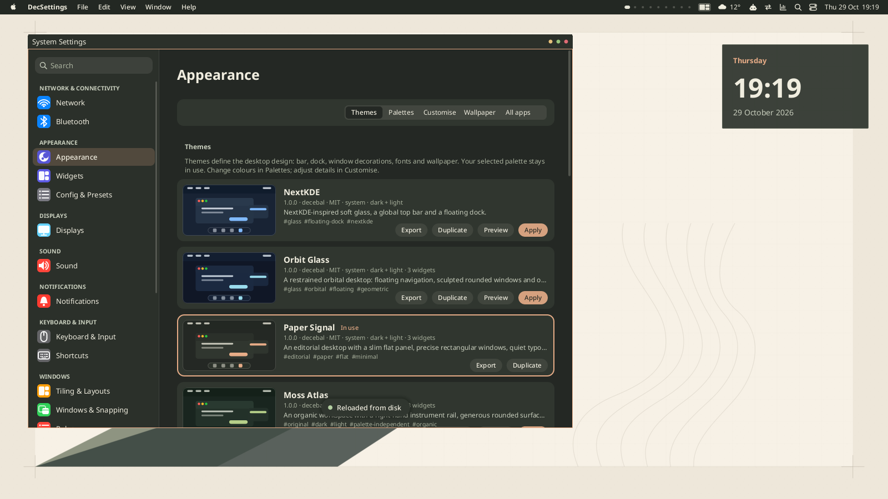 **Paper Signal** | Slim panel, square windows and an editorial paper composition. | `decthemectl theme apply paper-signal` |
| 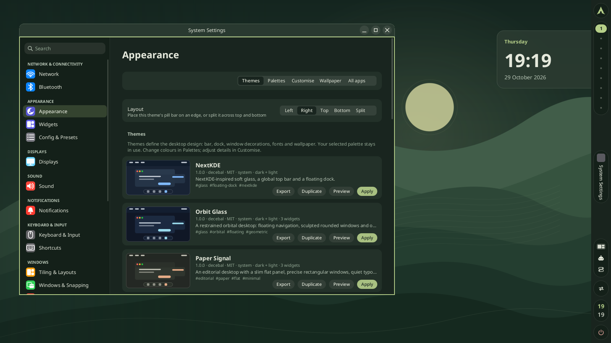 **Moss Atlas** | Right instrument rail, generous curves and organic terrain. | `decthemectl theme apply moss-atlas` |
| 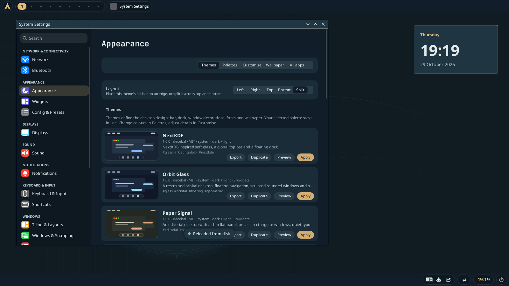 **Signal Deck** | Split navigation, technical typography and orbital geometry. | `decthemectl theme apply signal-deck` |

Research and provenance: [glass and paper](theme-research-glass-paper.md), [organic and retro](theme-research-organic-retro.md), [NextKDE](nextkde-port.md). Screenshots are captured on a private Xvfb desktop by `tests/e2e/theme-studio.sh`. No wallpaper art is bundled for these designs; changing theme/mode preserves the independently selected wallpaper.

Applying a theme selects the theme's own colours and clears the previous palette/custom accent. Afterwards, any palette can still be applied to that design. Widget selections and positions remain independent of this colour reset.

## Kiln Court and Tidal Loom

Two original dark/light rice packages with separately selected photography and optional shared
widget layouts. **Kiln Court** uses clay vaults, a bottom pill panel, no dock and
an upper-left clock/resource pair. **Tidal Loom** uses woven bands, a left rail,
compact taskbar and an upper-right clock/system pair. Apply with
`decthemectl theme apply kiln-court` or `decthemectl theme apply tidal-loom`.

See [design, attribution, native render evidence and follow-ups](rice-batch.md).
The gallery images are labelled headless compositions with real native widget
pixels and sample data. Generated art is retired; changing theme/mode preserves independently selected wallpaper.

## Screenshot ports

- **Mountain Neon Dot**: teal/rose/cyan, separately selected photography, transparent stacked
  dot clock, three widget islands, explicitly unconfigured homelab templates.
  [Mapping, provenance and limits](../themes/mountain-neon-dot/README.md).
- **Glyph Rice 1.1**: giant font-independent dot clock, six monochrome dashboard
  widgets, native left rail and enabled window buttons.
  [Mapping, attribution and limits](../themes/glyph-rice/README.md).

Both include actual native dark/light sample/empty widget evidence in
`docs/theme-ports/`. These are labelled headless compositions, not full desktop
captures. Theme ownership/backlog: [Theme Specialist](theme-specialist.md).

The gallery now [generates native previews automatically](theme-previews.md)
from package metadata and assets. Manual screenshots are optional evidence;
new themes and edits regenerate through the same isolated cache path.
