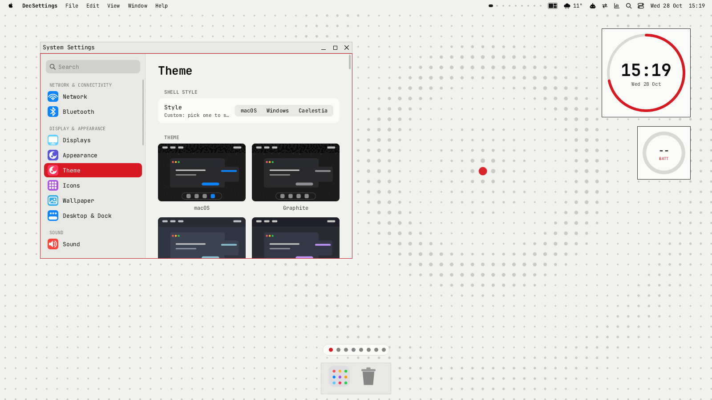
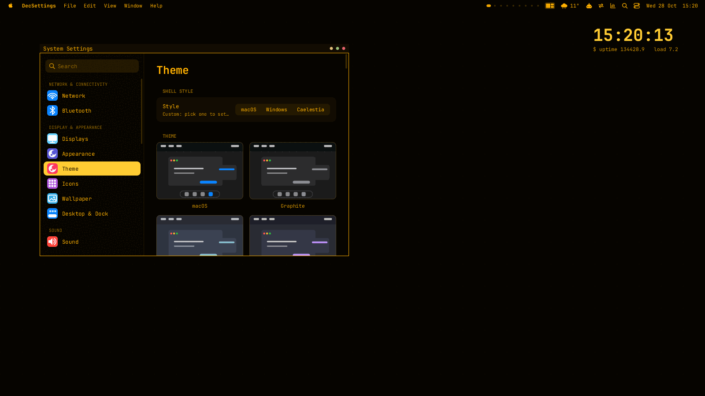

# Theme gallery

Ready-made looks that ship with decebal. Each one is a [theme package](theme-engine.md): colours for dark (and light where it makes sense),
fonts per role, titlebar style, bar and dock, a generated wallpaper and a few desktop widgets. Apply one with

```
decthemectl theme apply <id>              # whole package: colours, titlebars, bar, dock, wallpaper, widgets
decthemectl theme apply <id> --preview 10 # try it for 10 s, then everything is put back
decthemectl theme undo                    # step back
```

or with **System Settings -> Theme -> Theme packages**. The manifest is compiled into the programs; the wallpaper, widgets and screenshot live in
`themes/<id>/` and are installed by `make install` / the PKGBUILD / the .deb into `/usr/share/decebal/themes/<id>/`. Without that folder a
theme still applies (colours, fonts, titlebars, bar, dock) and `theme apply` prints a note that the wallpaper is missing. All wallpapers are
generated procedurally (PIL), under 30 KB each. Fonts are only named, never bundled: every chain ends in common monospace families.

| theme | look | apply |
|---|---|---|
|  | **Nothing Dot** (dark + light): dot-matrix monochrome after Nothing OS. Black or off-white, one red accent, square flat windows, a dot-grid wallpaper with a single red dot, a Glyph-style ring clock and battery. Titles and big numbers use Doto / DotGothic16 when installed, otherwise JetBrains Mono. | `decthemectl theme apply nothing-dot` |
|  | **Nothing Light**: the paper companion. Always light (the package has no dark variant), same ring widgets, light dot grid. | `decthemectl theme apply nothing-light` |
|  | **Brutalist** (dark + light): zero radius, 4 px borders, black and signal yellow at full contrast, monospace everywhere, flat yellow bar, a Windows-style square taskbar and a slab clock. The light variant is yellow paper with black ink. | `decthemectl theme apply brutalist` |
|  | **Terminal Minimal** (dark + light): green phosphor on black, a 20 px bar, no dock, thin titlebars, a plain tty clock on the desktop. Light variant: dark green ink on paper. | `decthemectl theme apply terminal-minimal` |
|  | **Terminal Amber** (dark + light): the same minimal terminal shell in amber phosphor (it `extends` Terminal Minimal and only changes colours, wallpaper and borders). Light variant: brown ink on cream. | `decthemectl theme apply terminal-amber` |

Add `light` or `dark` to pick a variant of a theme that has both: `decthemectl theme apply "brutalist light"`.

## Palettes: colours separate from themes

A theme is the *shape* of the desktop (titlebars, bar, dock, fonts, wallpaper, widgets). A **palette** is only colours, a dark and a light set,
and it works on every theme: pick one and it recolours whichever theme is active, and stays when you switch themes. The theme keeps its radius,
decoration, bar and dock; a palette also colours rdwm's borders (the theme's hard-coded border colours step aside).

| palette | dark / light |
|---|---|
| `catppuccin` | Mocha / Latte |
| `rose-pine` | Rose Pine / Dawn |
| `gruvbox` | dark / light |
| `tokyo-night` | Night / Day |
| `everforest` | dark / light |
| `kanagawa` | Wave / Lotus |
| `nord` | Polar Night / Snow Storm |
| `dracula` | Dracula / Alucard |
| `solarized` | dark / light |
| `monochrome` | greys / greys |

```
decthemectl palette list            # built-in and yours, * = current
decthemectl palette catppuccin      # recolour the current theme (and every theme you switch to)
decthemectl palette none            # back to each theme's own colours
decthemectl apply brutalist --accent "#ff8800"     # a custom accent sits on top of the palette
```
In System Settings the pages are now: **Theme** (shell style, theme gallery, packages, shape: corner radius, translucency, titlebars),
**Colours** (mode, palette gallery, accent, match wallpaper) and **Fonts** (presets, per-role families, text size).

Your own palette is a small file in `~/.config/decebal/palettes/<id>.toml` (`$DECEBAL_PALETTES`), the same colour tokens a theme has:

```toml
name = "Midnight"
description = "Deep blue with a mint accent."
[dark]
background = "#0b1020"   sidebar = "#080c18"   surface = "#141b33"   bar = "#080c18"   bar_text = "#e6ecff"
popup = "#141b33"   dock = "#080c18"   overlay = "#141b33"   titlebar = "#141b33"   titlebar_inactive = "#0b1020"
border = "#27315a"   text = "#e6ecff"   text_secondary = "#a9b4d6"   text_faint = "#7480a8"
accent = "#7df0c4"   accent_text = "#06231a"   danger = "#ff6b81"   ok = "#7df0c4"   warn = "#ffc46b"
```
A palette may have only `[dark]` or only `[light]`; the theme keeps its own colours in the other mode. Keep `text` readable (4.5:1) on every
surface; the built-in palettes are tested that way against every theme in both modes.

## Making your own

`decthemectl theme new mine --from nothing-dot` copies a theme into `~/.config/decebal/themes/mine/`; edit it, `decthemectl theme validate` it,
`decthemectl theme pack` it. See [theme-engine.md](theme-engine.md) for every key and the widget language.

## Tests

`cargo test` also applies every palette to every theme in both modes and checks contrast. `cargo test` checks that every shipped theme parses, validates as a package (wallpaper, widgets, screenshot present, compiled-in manifest equal
to the file) and applies; `tests/e2e/theme-engine.sh` applies each one on a private Xvfb and rdwm and takes the screenshots.
