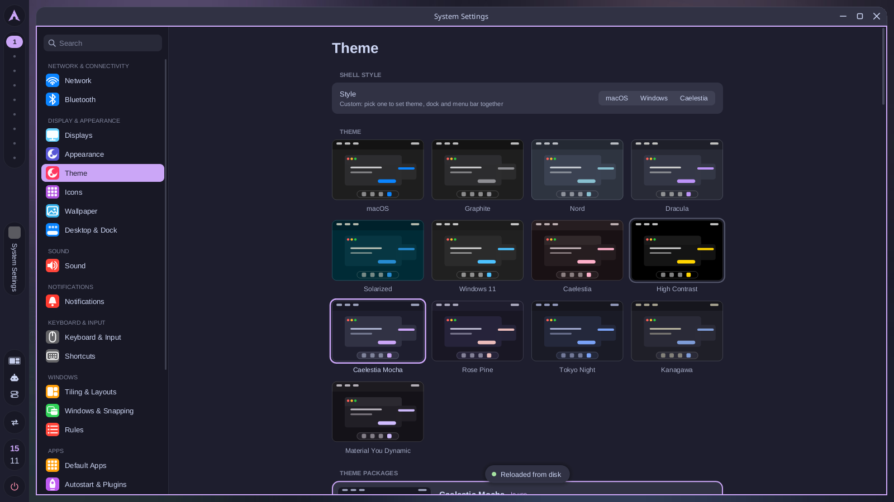
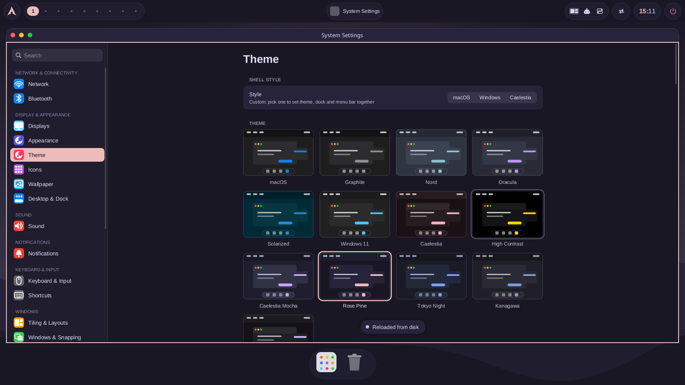
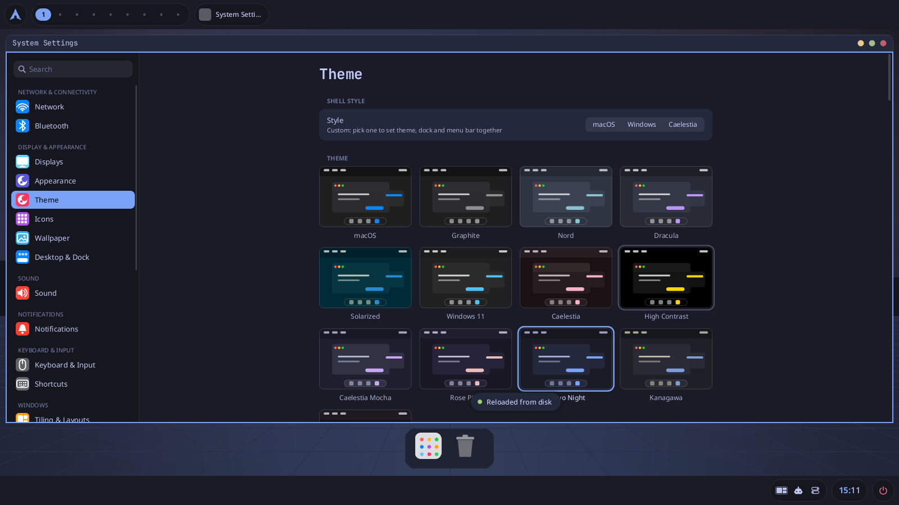
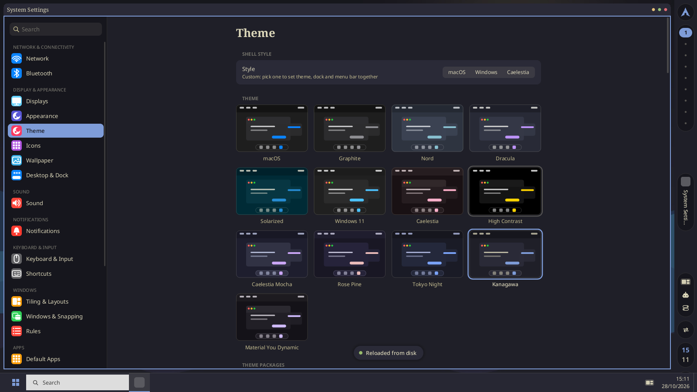
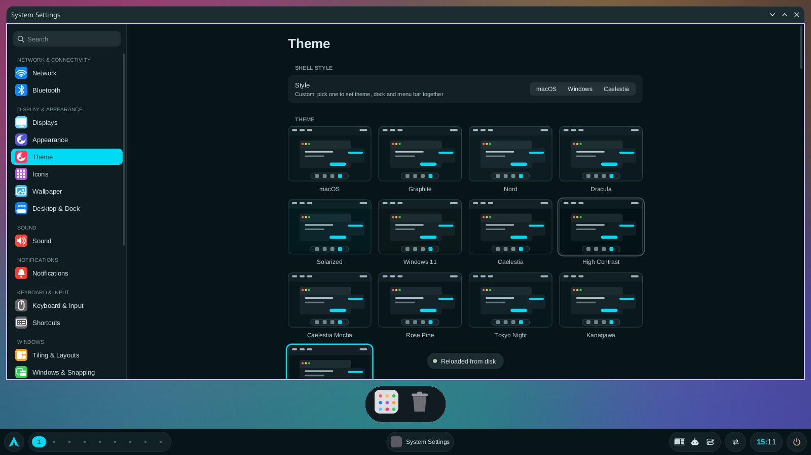
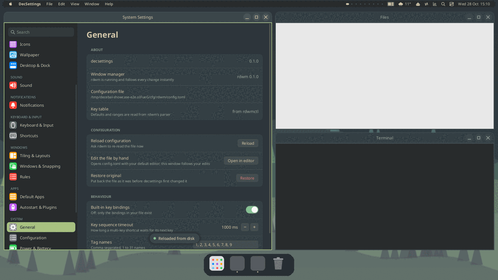
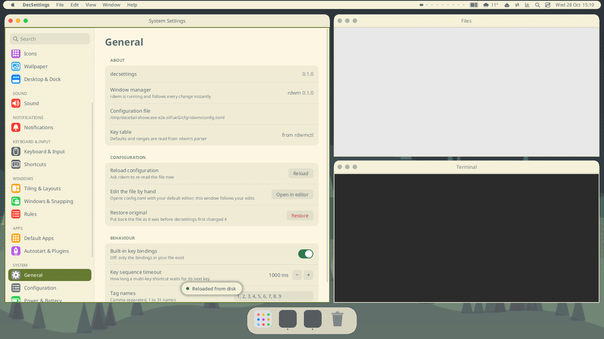

# Themes gallery

Five Caelestia-inspired theme packages ship with decebal (`themes/<id>/`, compiled in; the wallpapers are installed to
`/usr/share/decebal/themes/<id>/wallpapers/` by `make install` / the PKGBUILD, which is where a built-in theme finds its
picture). Each has a dark and a light variant, a generated wallpaper under 300 KB (no third-party artwork) and a different mix of bar position, dock
style and titlebar style. The screenshots (`docs/themes/<id>.png`, light variants `<id>-light.png`) are taken by `tests/e2e/themes.sh` on a private Xvfb
with `SHOTS=docs/themes tests/e2e/themes.sh`. The System Settings window in front is the Theme pane, which also lists them.

Apply one with `decthemectl theme apply <id>` (`--preview 10` to try it for 10 seconds, `decthemectl theme undo` to go back).
Anything can then be overridden by the user: `decthemectl theme duplicate <id> mine` makes an editable copy. See [theme-engine.md](theme-engine.md) and [caelestia.md](caelestia.md).

| Theme | Look | Bar | Dock | Titlebars | Apply |
|---|---|---|---|---|---|
|  | **Caelestia Mocha**: Catppuccin Mocha (Latte in light mode) in the Caelestia shape: a vertical pill bar on the left edge, 20 px radii, tonal mauve surfaces, no dock, Materia circle buttons. | left | hidden (auto) | materia | `decthemectl theme apply caelestia-mocha` |
|  | **Rose Pine**: Rose Pine dusk (Dawn in light mode): muted rose and gold on plum, a pill bar along the top, a round magnifying dock, traffic-light titlebars. | top | mac, pill | macos | `decthemectl theme apply rose-pine` |
|  | **Tokyo Night**: Tokyo Night (Day in light mode): electric blue and violet on navy with a neon skyline wallpaper, a split top and bottom bar, a compact dock, dot buttons. | split | mac, compact | nord | `decthemectl theme apply tokyo-night` |
|  | **Kanagawa**: Kanagawa Wave (Lotus in light mode): ink-wash blues on sumi ink, a pill bar on the right, serif window titles, a left-aligned Windows-style taskbar, thin minimal titlebars. | right | windows taskbar | minimal | `decthemectl theme apply kanagawa` |
|  | **Material You Dynamic**: Match wallpaper is on (vibrant scheme, full surfaces), so the shell takes its colours from the picture; a generated aurora gradient is bundled. Bottom pill bar, floating dock, Breeze titlebars. | bottom | mac, floating | breeze | `decthemectl theme apply material-you-dynamic` |

Tags: caelestia-mocha `catppuccin pill vertical-bar`, rose-pine `rose-pine top-bar dock`, tokyo-night `neon split-bar`, kanagawa `ink right-bar serif taskbar`, material-you-dynamic `material-you dynamic wallpaper`.

`material-you-dynamic` writes `theme.dynamic` (Match wallpaper) when applied and the next theme switches it off again; change the wallpaper and the colours follow, see [theming.md](theming.md#match-wallpaper).

## Showcase packages (gruvbox, everforest, synthwave, frutiger aero, adwaita-like)

Five data-only theme packages beyond the built-ins. They live in `themes/<id>/` (manifest, generated wallpapers, screenshot), are installed to
`/usr/share/decebal/themes/<id>/` by `make install`, and are used like any theme:

```
decthemectl theme apply <id>                 # dark or light follows the system; add --mode light|dark on `decthemectl apply`
decthemectl theme apply <id> --preview 10    # try it for 10 s, then everything is put back
decthemectl theme undo
```

Wallpapers are procedurally generated (no third-party artwork, each under 300 KB) and no fonts are bundled: font lists name families that are
commonly installed and fall back down the list. Screenshots are taken on a private Xvfb by `tests/e2e/showcase-themes.sh`. What the engine
cannot do yet (real glow or blur, bar item lists, a left-side window-button order) is described in [theme-engine.md](theme-engine.md).

## Gruvbox Dark


Warm retro tiling rice: a thin flat bar on top, square corners everywhere, tight gaps and Gruvbox's earthy palette (cream text on charcoal, orange accent), with flat GTK-style titlebars and topographic contour lines on the wallpaper. A light 'paper' variant is included.

Tags: gruvbox, retro, warm, tiling, square, dark, light. Apply: `decthemectl theme apply gruvbox-dark`

Light variant: 

## Everforest



A calm green-forest palette in soft rounded shapes: a bottom bar with a floating, rounded dock above it, gentle sage and moss accents on a deep slate-green base, soft Adwaita-style titlebars, and a layered misty-hills wallpaper with a pale moon. Light variant is a cream parchment.

Tags: everforest, green, calm, rounded, dark, light, nature. Apply: `decthemectl theme apply everforest`

Light variant: 

## Synthwave


Neon magenta and cyan on deep purple night: hot-pink accents, cyan borders on focused windows, a vertical pill bar on the left, dark glassy rounded surfaces and a generated retro sun-and-grid wallpaper with stars. The engine has no real glow, so the neon comes from saturated borders and bright accents; a light 'daybreak' variant keeps the same hues.

Tags: synthwave, neon, cyberpunk, purple, dark, light, retro. Apply: `decthemectl theme apply synthwave`

## Frutiger Aero


Early-2010s optimism: glossy light-aqua and sky-blue surfaces, big rounded glassy cards, a bubbles-and-hills sky wallpaper, a Windows 7 style taskbar with glass caption buttons on the right, and fresh green accents. Mostly a light theme; the dark variant is a deep-ocean version of the same look.

Tags: frutiger-aero, aqua, glass, light, dark, skeuomorphic, windows7. Apply: `decthemectl theme apply frutiger-aero`

## Adwaita-like


A clean libadwaita-inspired look in light and dark: rounded headerbar-style titlebars with a centred title and round flat buttons, the familiar blue/grey Adwaita palette, a slim top panel with a centred-feeling clock, soft blurred-colour wallpapers (one per variant) and Cantarell/Inter type. Not affiliated with or endorsing any GNOME project; no logos used.

Tags: adwaita, libadwaita, clean, light, dark, rounded. Apply: `decthemectl theme apply gnome-adwaita-like`

Light variant: 

## Gallery

| theme | look | apply |
|---|---|---|
| Gruvbox Dark | warm retro tiling: thin flat bar, square corners | `decthemectl theme apply gruvbox-dark` |
| Everforest | calm green forest, soft rounded, floating dock | `decthemectl theme apply everforest` |
| Synthwave | neon magenta and cyan on deep purple, sun-and-grid wallpaper | `decthemectl theme apply synthwave` |
| Frutiger Aero | glossy aqua and sky blue, glass cards, taskbar | `decthemectl theme apply frutiger-aero` |
| Adwaita-like | clean libadwaita-inspired headerbars, centred titles | `decthemectl theme apply gnome-adwaita-like` |
